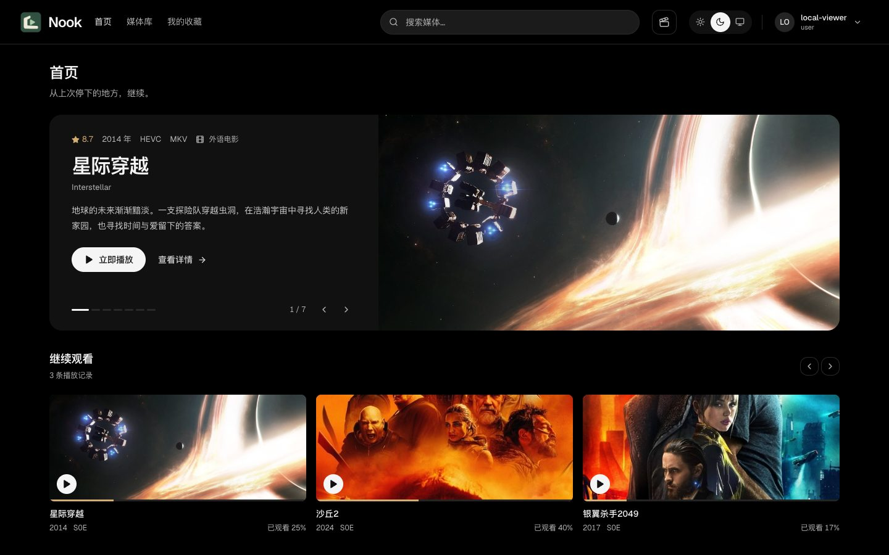
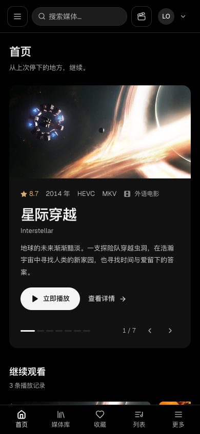
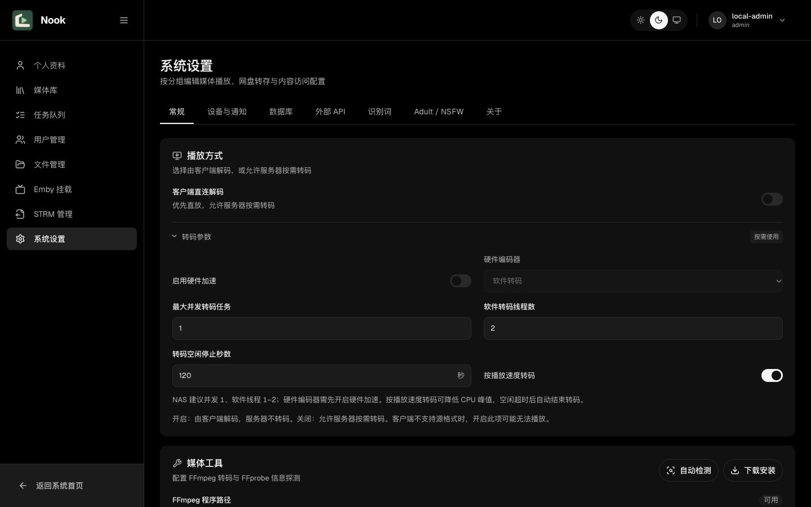
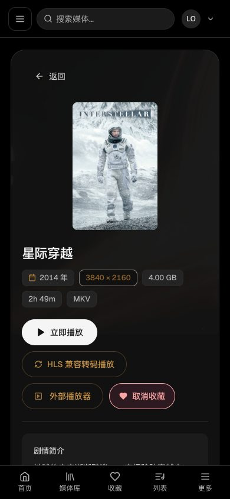

# 媒体浏览与管理界面样式改版

本轮统一首页、媒体卡片、详情、导航、个人设置和管理页的字体、间距与配色。沿用 Nook 标识及自托管 Geist，以中性黑灰区分页面层级；浅色主题使用同一套语义变量。评分与观看进度继续使用品牌金色。

桌面首页使用文案与横版剧照分栏，继续观看改为横向剧照卡片。手机媒体网格由三列调整为两列，详情页缩小海报并将原播放操作排在简介之前。虚拟网格的列数探针与响应式断点同步调整。播放器和阅读器保留专用布局，仅统一公共外观。

## 功能与兼容性

- 保留现有 API 客户端、请求与响应类型、认证状态、路由守卫和角色权限判断；后端无修改，无数据迁移。
- 首页轮播、续播、标签、媒体库分页与置顶、影片架滚动和剧集分组保留原处理函数。
- 媒体卡片保留评分、年份、集数/版本数、编码与进度，继续提供原收藏和管理员操作。
- 详情保留直放、HLS、外部播放器、收藏、版本切换和管理员工具；系统设置保留七个分组、字段校验及保存流程。
- 普通用户仍使用自身资料页及可访问的媒体库；管理员仍通过原管理入口操作。

## 验证范围

前端生产构建（含 TypeScript）及修改的 TSX 文件 ESLint 检查通过；`git diff --check` 通过。既有 libraryListSort、libraryTags、mediaVersion、useListPositionMemory、useScrollMemory 五个测试通过。

使用原 App 和本地隔离的样例接口检查 1440、768、390 三种宽度。检查了普通/管理员菜单与工具栏差异、普通角色访问管理页的重定向、搜索到详情、收藏反馈、剧集分组、横向影片架，以及系统设置未保存提示与保存反馈。另手动滚动检查首页和设置页下方内容，检查了浅色主题。

截图中的影片、用户、库数量、播放进度和配置值均为本地演示数据，不是线上数据。本地样例接口、账号入口与测试数据不包含在生产源码或本提交中。未执行线上数据写入或线上联调；真实播放、后台作业及全部认证流程不在本次端到端验证范围内。

## 页面截图

桌面首页：

手机首页：

管理员系统设置：

手机影片详情：

